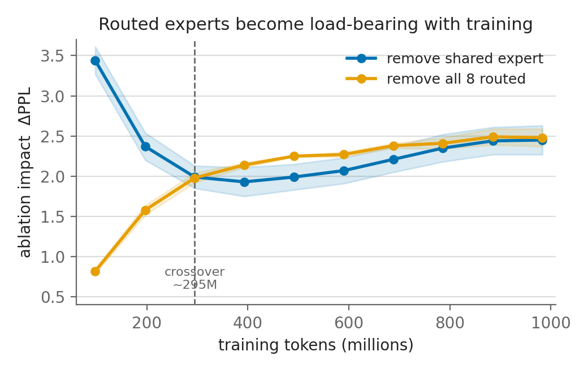
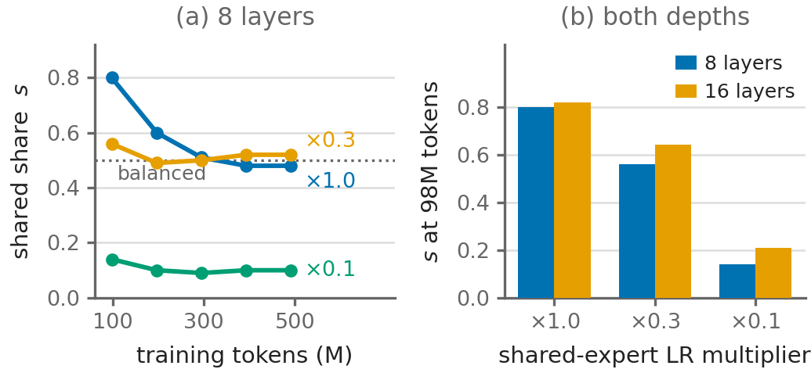
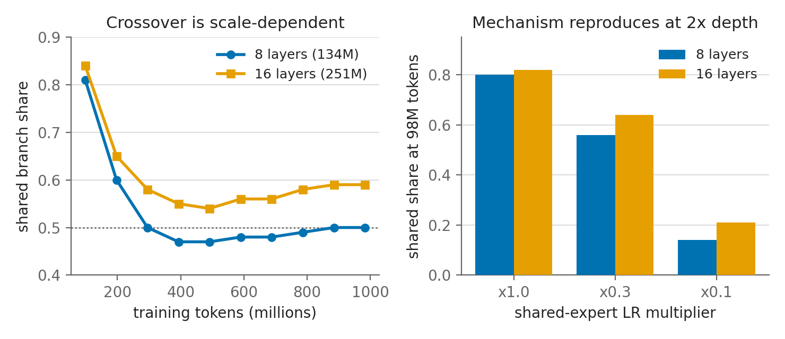
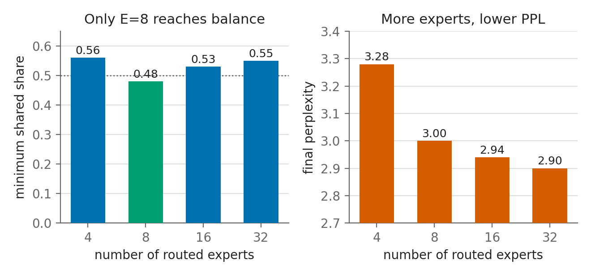
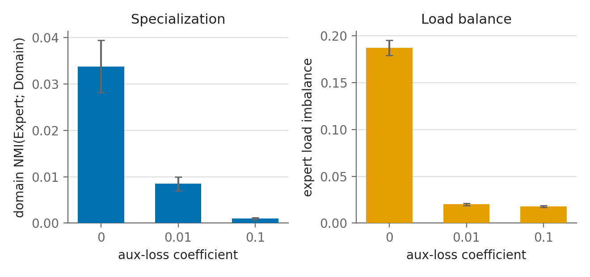

# Routed Experts Are Not Redundant: The Shared-Expert Gradient Race in Small Mixture-of-Experts Models

*Working draft (workshop length). Authors: TBD. All experiments run on a single NVIDIA RTX A6000.*

## Abstract

Small Mixture-of-Experts (MoE) language models with a DeepSeek-style shared expert are a
popular testbed for interpretability, because they are cheap to train and every token can be
labelled. A recurring observation in this regime is that the routed experts appear *redundant*:
ablating the entire routed branch barely changes perplexity, while the single always-on shared
expert dominates the feed-forward computation. We show that this "routed redundancy" is largely
an **artifact of undertraining**, and we identify its cause. Using a 134M-parameter MoE trained
from scratch on a three-domain, token-labelled corpus, we find that (i) the shared expert
carries ~80% of the feed-forward ablation impact at 98M tokens but the routed and shared
branches become **balanced by ~300M tokens** and stay balanced through 1B (4 seeds, tight error
bars); (ii) this early dominance is a **gradient-exposure race** — the shared expert receives
gradient from 100% of tokens versus ~k/E per routed expert, so it wins the early optimization
race; and (iii) the race is **causally controllable**: slowing the shared expert's learning rate
shifts the routed-activation crossover dose-dependently (the shared branch's share of ablation
impact at 98M tokens drops from 0.80 to 0.14) **at no perplexity cost**. A single hyperparameter
thus reallocates computation to the routed experts without changing model quality — useful when
one wants a small MoE to actually use its experts. The control **reproduces at 2× depth**, though
within our token budget the crossover to routed balance completes only at the smallest
configuration. We further report the axes of specialization
(surface form > domain > frequency, position irrelevant) and a non-monotonic dependence on the
number of experts. Two of our own early conclusions were overturned by seed replication and are
reported as such.

## 1. Introduction

Mixture-of-Experts layers replace a dense feed-forward block with a router that dispatches each
token to a small number of experts. The DeepSeekMoE design adds an always-on **shared expert**
alongside the **routed** experts, on the intuition that the shared expert absorbs common
computation and frees the routed experts to specialize. Because small MoEs are cheap and
controllable, they are widely used to study expert specialization.

In this small-scale regime, a striking and repeatedly observed phenomenon is that the routed
experts look nearly useless: removing all of them costs little perplexity, while removing the
lone shared expert costs a lot. It is tempting to conclude that small MoEs are over-parametrized
on the routed side, or that the shared expert suppresses the routed experts.

We show that this conclusion is **premature**. The apparent redundancy is a transient property
of early training that disappears with enough tokens, and its cause is a simple, controllable
optimization dynamic. Our contributions:

1. **Observation.** Branch importance is a function of tokens seen: routed "redundancy" and
   shared dominance vanish by ~300M tokens (Section 4).
2. **Mechanism.** The dominance is a *gradient-exposure race* — the shared expert is updated on
   every token, each routed expert on a k/E fraction — proven causally by slowing the shared
   expert and watching the crossover shift, at no quality cost (Section 5).
3. **Control and scope.** One hyperparameter (shared-expert learning rate) sets when/whether the
   routed experts engage; the dependence on the number of experts is non-monotonic, not the
   clean law the mechanism naively predicts (Section 6).

Along the way we characterize *what* the experts specialize by, and we explicitly retract two
early findings that did not survive replication (Section 7). We view the honest, seed-replicated,
causal methodology as part of the contribution.

## 2. Setup

**Model.** A decoder-only MoE re-implemented from scratch in PyTorch: Multi-head Latent Attention
(MLA), RoPE, RMSNorm, and per layer a MoE block with 8 routed experts + 1 shared expert and
top-2 routing (134M parameters, 8 layers, hidden 512, context 512). During analysis we run the
MoE in inference mode (no capacity dropping).

**Data.** Pre-training streams three token-labelled corpora: FineWeb-Edu (`web`, 60%),
Cosmopedia-v2 (`edu`, 25%), OpenWebMath (`math`, 15%), tokenized with the Mistral vocabulary
(32k). Sequences are packed to 512 tokens. The domain labels are the key lever: they let us
attribute routing to a known variable. Held-out per-domain evaluation packs each domain
separately (one label per sequence).

**Metrics.** *Branch importance*: ΔPPL from ablating a whole branch (all routed experts, or the
shared expert). This whole-branch ablation is the correct causal probe — single-expert ablation
is misleading because top-2 routing reroutes to the survivors. *Specialization*: gate-weighted
normalized mutual information NMI(Expert; axis) = I/H, averaged over layers, against a
label-permutation null (≈0 everywhere). *Balance*: std of top-1 expert load. Between-condition
tests are exact permutation tests on seed-level values.

**Compute.** All runs are on one RTX A6000 using a plain single-GPU trainer; the largest models
see ~1B tokens (~3.4h each).

## 3. Related work

**Sparse MoE layers.** Conditional computation via a sparsely-gated MoE layer was introduced by
Shazeer et al. [2017] and scaled by GShard [Lepikhin et al., 2021] and Switch Transformer
[Fedus et al., 2022], which also established the auxiliary load-balancing loss. ST-MoE [Zoph et
al., 2022] added the router z-loss for stability. Our model uses both, in a top-2 configuration
[Jiang et al., 2024].

**Shared experts.** DeepSeekMoE [Dai et al., 2024] introduced the always-on shared expert
alongside fine-grained routed experts, arguing it absorbs common knowledge and thereby *frees*
the routed experts to specialize; the design carries through DeepSeek-V2/V3 [DeepSeek-AI, 2024a,b],
which also motivate auxiliary-loss-free routing by the balance–specialization tension. We
reproduce the "shared enables specialization" effect (Section 7) but show it is only visible once
balancing is off, and — more importantly — that at small scale the shared expert *dominates* the
computation for a mechanistic reason unrelated to specialization.

**Expert specialization studies.** Analyses of Mixtral [Jiang et al., 2024] report that experts
specialize more by token/syntactic identity than by topic; OLMoE [Muennighoff et al., 2024]
studies specialization and routing saturation across training in open MoEs. We add a controlled,
domain-labelled probe with causal branch ablation and, crucially, identify a training-dynamics
cause for the small-scale "routed redundancy" that these observational studies do not address.

**Architecture components.** Our backbone uses MLA [DeepSeek-AI, 2024a], RoPE [Su et al., 2021],
RMSNorm [Zhang and Sennrich, 2019], and optional YaRN context extension [Peng et al., 2023];
the distillation experiment follows Hinton et al. [2015] with a Mistral-7B teacher [Jiang et al.,
2023]. Pre-training data are FineWeb-Edu [Penedo et al., 2024], Cosmopedia-v2 [Ben Allal et al.,
2024], and OpenWebMath [Paster et al., 2023].

To our knowledge, the central claim — that small-MoE routed redundancy is an *undertraining
artifact* caused by a *gradient-exposure race* between the shared and routed experts, and is
*causally controllable* by the shared-expert learning rate at no quality cost — is new.

## 4. Routed "redundancy" is an undertraining artifact

We train the base model for 30k steps (~983M tokens, batch 64), 4 seeds, and measure branch
importance at each checkpoint (mean ± std):

| tokens | held-out PPL | remove shared | remove all 8 routed | shared share |
|---|---|---|---|---|
| 98M  | 4.18 | +3.44 ± 0.17 | +0.82 ± 0.03 | **0.81** |
| 197M | 3.63 | +2.37 ± 0.17 | +1.58 ± 0.06 | 0.60 |
| 295M | 3.41 | +1.99 ± 0.14 | +1.98 ± 0.06 | **0.50** |
| 491M | 3.20 | +1.99 ± 0.16 | +2.25 ± 0.01 | 0.47 |
| 983M | 3.00 | +2.45 ± 0.18 | +2.48 ± 0.11 | 0.50 |

*Figure 1: Ablation impact (ΔPPL) of removing the shared expert vs. all 8 routed experts, over a
4-seed constant-batch training trajectory (bands = ±1 std). The shared expert dominates early;
the branches cross to balance by ~295M tokens.*

("Shared share" = remove-shared ΔPPL / (remove-shared + remove-routed).) At 98M tokens — the
regime of many pilot studies and of our own early experiments — the shared expert carries 81% of
the ablation impact and the routed experts look nearly redundant. The crossover to balance
happens by **~295M tokens**, after which the branches contribute equally through 1B. All four
seeds follow the same trajectory with tight error bars; routed specialization grows in parallel
(NMI 0.0008 → 0.017). **Conclusions drawn about routed redundancy or shared dominance below a few
hundred million tokens do not generalize.**

## 5. The mechanism: a gradient-exposure race

Why does the shared expert dominate early? It is updated on **every** token; each routed expert
is updated on only a `k/E` = 2/8 = 25% fraction. The shared expert therefore wins the early
optimization race and the residual stream comes to rely on it; the routed experts become
load-bearing only once the shared expert saturates.

**Formalization.** Consider one MoE block whose output on token *t* is
`y_t = s(x_t) + Σ_{e∈topk(t)} g_{t,e} f_e(x_t)`, where `s` is the shared expert and `f_e` the
routed experts. Over a batch of *N* tokens, the shared parameters receive a gradient signal
aggregated over all *N* tokens, whereas a routed expert *e* receives gradient only from the
`≈ N·k/E` tokens routed to it. Under a shared learning rate, the shared expert thus accumulates
roughly `E/k×` more effective updates per parameter early in training, when the loss gradient is
large and the allocation of "who computes what" is still plastic. The residual pathway
greedily routes common computation to whichever sub-module reduces loss fastest — the shared
expert — which further starves the routed experts of useful gradient (a rich-get-richer
dynamic). This yields two testable predictions: (i) reducing the shared expert's learning rate
should let the routed experts capture computation earlier (tested below, confirmed); and (ii) the
crossover token count should grow with `E/k` (tested in Section 6, only partially confirmed —
total routed capacity also matters).

We test this causally by placing the shared-expert parameters in their own optimizer group at
`lr × mult` and leaving everything else at the base learning rate (2 seeds, values at 98M
tokens):

| shared LR | remove routed ΔPPL | remove shared ΔPPL | shared share | PPL |
|---|---|---|---|---|
| ×1.0 (baseline) | +0.85 | +3.46 | **0.80** | 4.16 |
| ×0.3 | +1.94 | +2.48 | 0.56 | 4.10 |
| ×0.1 | **+4.46** | +0.72 | **0.14** | 4.10 |

*Figure 2: The shared branch's share of ablation impact vs. tokens, for three shared-expert
learning-rate multipliers (2 seeds). Slowing the shared expert (×0.3, ×0.1) shifts the
routed-activation crossover earlier, dose-dependently — at unchanged perplexity.*

Slowing the shared expert makes the routed branch load-bearing **dramatically earlier** — a 5×
increase in routed importance at a *fixed* token budget — shifting the crossover from ~295M
tokens (baseline) to <100M (×0.3) to before training even settles (×0.1, where routed dominate
from the start). The effect is monotonic, dose-dependent, and has tight error bars. This
**refutes autonomous routed maturation**: the routed experts were being out-competed, not merely
immature.

Crucially, **held-out perplexity is unchanged** across conditions (if anything slightly better).
The shared expert is therefore not *necessary* for this computation; the model defaults to
placing it there because that expert trains fastest. A single knob reallocates computation to the
routed experts at no quality cost — which is exactly what one wants if the goal is a small MoE
whose routed experts are actually used (for interpretability, expert pruning, or modularity).

### Does the mechanism hold at scale?

We repeat the shared-LR sweep on a 2×-deeper model (16 layers, 251M parameters, 1 seed;
Figure 5). The **control reproduces almost exactly**: at 98M tokens the shared share drops
0.82 → 0.64 → 0.21 for ×1.0/×0.3/×0.1 (vs 0.80/0.56/0.14 at 134M), dose-dependent and at
unchanged perplexity. The gradient-race mechanism and its knob are therefore robust to depth.

The crossover *timing*, however, is scale-dependent. The deeper baseline (×1.0) only reaches a
minimum share of 0.54 (~491M tokens) and does **not** cross to balance within 1B tokens — the
shared expert re-asserts dominance (0.59 at 983M), the same dip-then-rise seen for larger E
(Section 6). Deeper models stay in the shared-dominated regime for many more tokens; "enough
tokens" for routed balance grows with model size, which is mechanistically consistent (more
residual capacity compounds the shared expert's head start). This *strengthens* the practical
warning — undertrained diagnosis is even more misleading at scale — but means we observe the
crossover *complete* only at our smallest configuration; at 251M it approaches but does not
complete within our 1B-token budget.

*Figure 5: (left) the shared branch's share vs. tokens for the baseline at two depths — the 8-layer
model crosses to balance, the 16-layer model approaches but does not within 1B tokens; (right) the
shared-LR control reproduces at 2× depth, dropping the share dose-dependently at both scales.*

## 6. Scope: the #experts dependence is non-monotonic

The gradient-race picture naively predicts the crossover should scale ∝ E/k. We test
E ∈ {4, 8, 16, 32} (top-2, batch 64, full trajectories) and find this clean law **does not
hold**. The minimum shared share reached during training:

| #experts | min shared share | crosses 0.5? | final PPL |
|---|---|---|---|
| 4 | 0.56 | no | 3.28 |
| **8** | **0.48** | **yes** | 3.00 |
| 16 | 0.53 | no | 2.94 |
| 32 | 0.55 | no | 2.90 |

*Figure 3: (left) minimum shared share reached during training vs. number of routed experts —
only E=8 crosses to balance; (right) more experts monotonically improve perplexity. Engagement
and perplexity are optimized at different granularities.*

The dependence is **non-monotonic**, with a "Goldilocks" optimum at E=8: only there do the
routed experts fully reach balance. The mechanism explains the high-E side (E=8→16→32: as each
routed expert's gradient share k/E shrinks, the shared expert grows more dominant) but fails at
E=4, which stays shared-dominant despite the *highest* per-expert gradient share — implicating a
second factor, total routed capacity (E=4 has half of E=8's routed parameters). There is a
practical tension: more experts improve perplexity (2.90 at E=32) but leave the routed experts
individually more under-used. We report this as an honest, nuanced secondary result rather than a
clean law.

## 7. Supporting characterization and retracted findings

**What experts specialize by.** On models trained without the load-balancing loss (where
specialization is strongest), NMI(Expert; axis) is largest for **surface form** (0.050),
then domain (0.034), then token frequency (0.028), and essentially zero for sequence position
(0.0003). A conditional-MI check shows the axes are separable — domain routing information is
fully retained after conditioning on surface class — so domain specialization is genuine, not a
surface-form artifact. This reproduces, in a controlled labelled setting, prior reports that
experts organize more by token/surface than by topic.

**Load balancing controls specialization.** Sweeping the auxiliary loss coefficient
{0, 1e-2, 1e-1} moves domain NMI monotonically (0.034 / 0.0085 / 0.0010; all pairwise
permutation tests significant) and load imbalance in lockstep, at no perplexity cost — the
balance↔specialization tension is set by one coefficient.

*Figure 4: Domain specialization (left) and expert load imbalance (right) vs. the auxiliary
load-balancing coefficient (4 seeds, ±1 std). Both fall monotonically as balancing strengthens.*

**Shared expert enables specialization.** With balancing off, routed domain-NMI is higher *with*
the shared expert (0.034) than without (0.015, p=0.029): the shared expert acts as a
common-capability backstop, consistent with the DeepSeekMoE intuition.

**Two retracted findings.** (a) At 3 seeds, removing the shared expert appeared to sharpen routed
specialization; at 4 seeds this collapsed (p=0.54) and, once balancing is off, the sign reverses.
(b) We hypothesized the shared monopoly was a *pathology*; a per-token shared-branch dropout
breaks the monopoly entirely (shared share → 0.01) but yields no perplexity gain and no
specialization gain — consistent with Section 5's conclusion that the shared/routed split is a
near-neutral reparametrization. We report both as negatives.

**Distillation (preliminary).** On-the-fly distillation from a Mistral-7B teacher, compared to a
batch/step-matched from-scratch control at 98M tokens, appears to engage the routed branch more
(remove-routed +1.03 → +1.74) but at a small next-token PPL cost and from a single seed; not
established.

## 8. Limitations

Pilot scale (134M parameters, ≤1B tokens, 8 experts, 512 context, a single hardware
configuration and data mix). Held-out evaluation uses a skip-offset of the training streams
rather than a fully disjoint split. Held-out NMI and branch-importance magnitudes are sensitive
to batch size at fixed token count, so cross-experiment magnitude comparisons should use matched
batches; the within-experiment, matched-batch comparisons and the token trajectories are the
reliable ones. Distillation results are single-seed. Whether the ~300M-token crossover and the
gradient-race control persist at larger scale is untested.

## 9. Practical recommendations

For practitioners training or studying small shared-expert MoEs:

1. **Do not diagnose expert redundancy on an undertrained model.** Below a few hundred million
   tokens the shared expert dominates for optimization reasons, not architectural ones; measure
   branch importance as a trajectory, not at a single early checkpoint.
2. **To engage the routed experts sooner, slow the shared expert** (a modest LR multiplier,
   e.g. ×0.3). This reallocates computation to the routed branch at no measured perplexity cost —
   valuable when routed experts are the object of study (interpretability, expert pruning,
   modular editing) or when a balanced load is desired for systems reasons.
3. **Pick the number of experts for engagement, not just perplexity.** More experts monotonically
   improved perplexity here but left the routed experts individually more under-used; engagement
   was maximized at an intermediate count (E=8 in our setup).
4. **Report seeds and use matched batch sizes.** Both the sign of a specialization effect (our
   retraction (a)) and the magnitude of branch-importance metrics were sensitive to seed and
   batch size at fixed tokens.

## 10. Conclusion

In small shared-expert MoEs, the routed experts are not redundant — they are out-competed by the
shared expert in a gradient-exposure race that resolves with training and that a single learning
-rate knob controls at no quality cost. The practical takeaways are concrete: do not diagnose
expert redundancy on an undertrained MoE, and if you want the routed experts engaged sooner, slow
the shared expert. The methodology — a cheap, controllable, domain-labelled testbed with causal
branch ablation, seed replication, and the willingness to retract — is offered alongside the
findings.

## 11. Reproducibility

All code, configs, and the analysis toolkit (branch ablation, routing capture, NMI /
conditional-MI, permutation tests, the trajectory and mechanism drivers) are in the repository;
every experiment runs on a single GPU. Two implementation bugs found and fixed during the study —
a missing causal mask in the absorbed-MLA inference path, and a broken CUDA `torch.dot` in the
load-balancing loss — are documented in the commit history.
